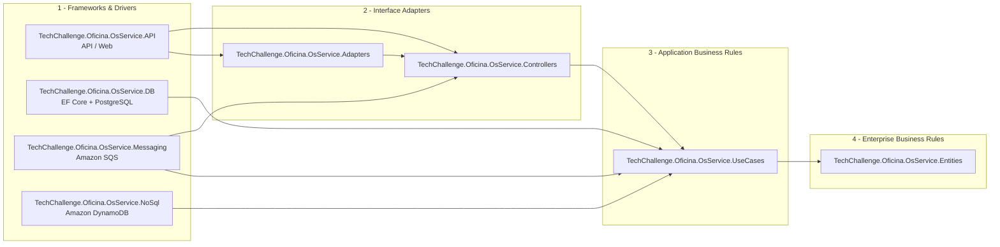
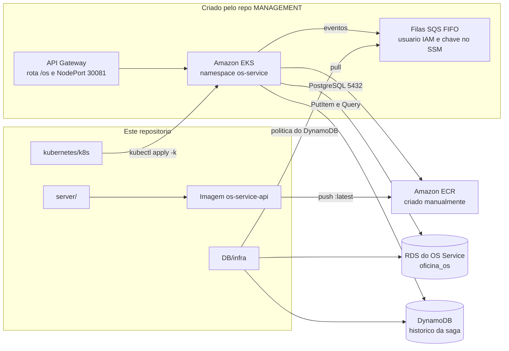

# Projeto Oficina — OS Service

## 1. Identificação

Microsserviço de ordens de serviço (OS) do software de gestão de uma oficina mecânica.

Tech Challenge da Fase 4 do curso SOAT16 da FIAP. Na fase 4, o ciclo de vida da OS saiu do serviço Management e virou este microsserviço, com banco, namespace no Kubernetes e pipelines próprios ([ADR-019](./docs/adr/ADR-019-OS-Service-Microsservico-com-Banco-Proprio.md)).

O sistema tem cinco repositórios:
- **OS-SERVICE** (este): abertura, atualização, consulta e status da OS (só este serviço muda o status: a entrega pela rota, e as demais mudanças por eventos dos outros serviços), e os indicadores.
- [MANAGEMENT](https://github.com/GuiToniello/tech-challenge-fase-4-MANAGEMENT-soat16-rm374658): cadastros (clientes, veículos, serviços e insumos), estoque, validação da OS e o e-mail de mudança de status. Também cria a rede, o cluster EKS, o API Gateway, o Datadog e as filas SQS que este repositório usa.
- [BILLING](https://github.com/GuiToniello/tech-challenge-fase-4-BILLING-soat16-rm374658): orçamento (gerar, enviar por e-mail, aprovar e recusar) e pagamento pelo Mercado Pago, com banco próprio ([ADR-021](https://github.com/GuiToniello/tech-challenge-fase-4-BILLING-soat16-rm374658/blob/main/docs/adr/ADR-021-Billing-Service-Orcamento-e-Pagamentos-com-Banco-Proprio.md)).
- [EXECUTION](https://github.com/GuiToniello/tech-challenge-fase-4-EXECUTION-AND-PRODUCTION-soat16-rm374658): Execução e Produção, com banco próprio: a fila de produção da oficina, o início do diagnóstico e o início e a finalização da execução ([ADR-023](https://github.com/GuiToniello/tech-challenge-fase-4-EXECUTION-AND-PRODUCTION-soat16-rm374658/blob/main/docs/adr/ADR-023-Execucao-e-Producao-Fila-de-Execucao-e-Status-por-Eventos.md)). Avisa este serviço por eventos (`DiagnosticoIniciado` e `ExecucaoFinalizada`).
- [LAMBDA](https://github.com/GuiToniello/tech-challenge-fase-4-LAMBDA-soat16-rm374658): autenticação (Lambda authorizer e `POST /auth/token`).

Os serviços se comunicam só por eventos no Amazon SQS ([ADR-020](https://github.com/GuiToniello/tech-challenge-fase-4-MANAGEMENT-soat16-rm374658/blob/main/docs/adr/ADR-020-Eventos-com-SQS-e-Saga-Coreografada.md)): não há chamadas HTTP entre as APIs, e nenhum serviço lê o banco do outro. Além do próprio banco e do SQS, este serviço usa uma tabela do Amazon DynamoDB, com o histórico da saga de cada OS ([ADR-026](./docs/adr/ADR-026-Historico-da-Saga-no-DynamoDB.md)).

Grupo:
-  Guilherme Toniello Vieira -  SOAT16 - rm374658

### 1.1 Estrutura do repositório

```
/
├── server/               Solução .NET: OS Service, camadas da Clean Architecture e testes
├── e2e/                  Collection do Postman (OS, indicadores e saga) e environment da AWS
├── docker-compose.yml    Postgres + ElasticMQ (SQS local) + DynamoDB Local + OS Service para rodar localmente
├── elasticmq.conf        Filas FIFO do ElasticMQ, as mesmas do SQS na AWS
├── DB/infra/             Terraform do Amazon RDS PostgreSQL e da tabela DynamoDB do OS Service
├── kubernetes/k8s/       Manifests Kubernetes do OS Service (Kustomize)
├── docs/                 ADR-019, ADR-026 e observabilidade
└── .github/workflows/    Pipelines (build, testes, imagem, Terraform do banco e deploy no cluster)
```

| Pasta | O que tem | Documentação |
|---|---|---|
| [server/](./server/) | Código .NET 10 da `TechChallenge.Oficina.OsService.API` e testes | Seções 2 a 4 deste README |
| [e2e/](./e2e/) | Collection do Postman e environment da AWS | Seção 7 |
| [DB/infra/](./DB/infra/) | Amazon RDS PostgreSQL, tabela DynamoDB do histórico da saga e a política IAM dela (state `techchallenge-oficina/fase-4/os-service-database.tfstate`) | Seção 5 |
| [kubernetes/k8s/](./kubernetes/k8s/) | Namespace, ConfigMap, Secret, Deployment, Service e HPA do `os-service-api` | Seção 5 |
| [docs/](./docs/) | [ADR-019](./docs/adr/ADR-019-OS-Service-Microsservico-com-Banco-Proprio.md), [ADR-026](./docs/adr/ADR-026-Historico-da-Saga-no-DynamoDB.md) e o [contrato de observabilidade](./docs/observabilidade.md) deste serviço | Seção 8 |
| [.github/workflows/](./.github/workflows/) | Bootstrap, Deploy, Destroy e K8s Apply | [.github/workflows/README.md](./.github/workflows/README.md) |

## 2. Arquitetura

A visão geral do sistema (diagrama de componentes e diagramas de sequência da autenticação e da saga) está no [docs/arquitetura.md do MANAGEMENT](https://github.com/GuiToniello/tech-challenge-fase-4-MANAGEMENT-soat16-rm374658/blob/main/docs/arquitetura.md).

O código segue a mesma Clean Architecture da Management ([ADR-001](https://github.com/GuiToniello/tech-challenge-fase-4-MANAGEMENT-soat16-rm374658/blob/main/docs/adr/ADR-001-Clean-Architecture.md)), com 4 anéis e as dependências sempre apontando para dentro:



Os padrões são os mesmos da Management: folder-by-feature, Gateways, Commands/Queries/ViewModels (CQS), AutoMapper nos UseCases, EF Core com PostgreSQL e migrations no startup, Swagger, erros em duas camadas e logs JSON com Serilog. A mensageria segue o padrão do e-mail da Management: os casos de uso publicam pela porta `IEventosPublisher`, e o projeto Messaging implementa a publicação e o consumidor da fila. O evento consumido entra pelo [EventosController](./server/2%20-%20Interface%20Adapters/TechChallenge.Oficina.OsService.Controllers/Features/Eventos/EventosController.cs), como uma requisição HTTP entra por um endpoint. O histórico da saga segue o mesmo padrão: os casos de uso gravam e consultam pela porta `IHistoricoSagaGateway`, e o projeto NoSql a implementa com o SDK do DynamoDB (seção 2.4).

### 2.1 Responsabilidades

| Fica neste serviço | Fica na Management | Fica no Billing | Fica no Execução e Produção |
|---|---|---|---|
| Abrir, atualizar (só com a OS `Recebida`), excluir e consultar a OS | Clientes, veículos, serviços, insumos e estoque (com o débito no pagamento aprovado) | Orçamento: gerar, consultar, enviar por e-mail, aprovar e recusar | Fila de produção da oficina (`GET /api/execucoes/fila`) |
| Mudar o status da OS (só este serviço muda): a entrega pela rota, e as demais mudanças pelos eventos dos outros serviços | Validação dos cadastros da OS (cliente, veículo do cliente e serviços), com os preços para o Billing | Pagamento pelo Mercado Pago (link do Checkout Pro, consulta e webhook) | Iniciar o diagnóstico e iniciar e finalizar a execução, avisando este serviço por eventos |
| Histórico de status, valor do orçamento e motivo do cancelamento | E-mail de mudança de status | E-mail do orçamento | Cópia do status da OS, alimentada pelo `OrdemServicoStatusAlterado` |
| Indicadores: tempo médio de execução e de entrega | | | |
| Histórico da saga de cada OS no DynamoDB (o que este serviço fez com cada evento consumido), complementar ao histórico de status gravado no PostgreSQL | Histórico de movimentações de estoque de cada insumo, em outra tabela DynamoDB | Histórico dos eventos de pagamento, em outra tabela DynamoDB | Linha do tempo da produção, em outra tabela DynamoDB |

A OS guarda só os ids do cliente, do veículo e dos serviços. A validação desses ids é feita pela Management, por evento: se algum cadastro não existir, ela rejeita a OS, e este serviço a cancela (status `Cancelada`, com o motivo). A OS só entra em execução com o pagamento aprovado no Billing (evento `PagamentoAprovado`): não há rota para isso, e o pagamento não pode ser pulado.

Com o Execução e Produção, as rotas `POST /api/ordens-servico/{id}/em-diagnostico`, `/em-execucao` e `/finalizar` saíram deste serviço. O diagnóstico começa em `POST /api/execucoes/{osId}/iniciar-diagnostico` e a execução termina em `POST /api/execucoes/{osId}/finalizar`, no Execução e Produção, que publica `DiagnosticoIniciado` e `ExecucaoFinalizada`; este serviço muda o status ao consumir esses eventos. A listagem `/ordenadas` continua aqui, como o acompanhamento do ciclo de vida das OS em aberto; a fila de produção da oficina é a `GET /api/execucoes/fila`, do Execução e Produção.

### 2.2 Eventos

Envelope JSON (camelCase): `{"id","tipo","versao":1,"ocorridoEm","origem","dados"}`, com `origem` = `os-service` nos eventos publicados aqui. As filas são FIFO, com `MessageGroupId` = id da OS (ordem garantida por OS) e `MessageDeduplicationId` = id do envelope. Os contratos ficam em [Features/Eventos/Contratos](./server/3%20-%20Application%20Business%20Rules/TechChallenge.Oficina.OsService.UseCases/Features/Eventos/Contratos/), uma cópia dos contratos que este serviço usa (os mesmos da Management, do Billing e do Execução e Produção).

| Evento | Direção | Quando | Dados |
|---|---|---|---|
| `OrdemServicoAberta` | Publicado (→ Management, Billing e Execução e Produção) | Depois de gravar a OS (`POST /api/ordens-servico`) | `ordemServicoId`, `clienteId`, `veiculoId`, `servicoIds` |
| `OrdemServicoAtualizada` | Publicado (→ Management, Billing e Execução e Produção) | Depois de gravar a atualização (`PUT /api/ordens-servico`) | Os mesmos de `OrdemServicoAberta` |
| `OrdemServicoStatusAlterado` | Publicado (→ Management, Billing e Execução e Produção) | Depois de cada mudança de status, pela rota ou por evento | `ordemServicoId`, `clienteId`, `statusAnterior`, `statusNovo` |
| `OrdemServicoExcluida` | Publicado (→ Management, Billing e Execução e Produção) | Depois de excluir a OS | `ordemServicoId` |
| `OrdemServicoRejeitada` | Consumido (← Management) | Algum cadastro da OS não existe | `ordemServicoId`, `motivo` → OS `Cancelada` (compensação) |
| `OrcamentoGerado` | Consumido (← Billing) | Orçamento gerado (ou gerado de novo) | `ordemServicoId`, `valorTotal` → OS `AguardandoAprovacao`, com o valor |
| `PagamentoAprovado` | Consumido (← Billing) | Pagamento do orçamento aprovado no Mercado Pago (ou no modo simulado) | `ordemServicoId`, `pagamentoId`, `valor` → OS `EmExecucao` |
| `OrcamentoRecusado` | Consumido (← Billing) | Orçamento recusado | `ordemServicoId` → OS `Finalizada` |
| `DiagnosticoIniciado` | Consumido (← Execução e Produção) | Diagnóstico iniciado na fila de produção | `ordemServicoId` → OS `EmDiagnostico` (de `Recebida`) |
| `ExecucaoFinalizada` | Consumido (← Execução e Produção) | Execução finalizada na fila de produção | `ordemServicoId` → OS `Finalizada` (de `EmExecucao`) |

- **Fila consumida:** `techchallenge-oficina-os-service.fifo`. **Filas de publicação** (lista `SqsSettings:FilasPublicacao`): `techchallenge-oficina-management.fifo`, `techchallenge-oficina-billing.fifo` e `techchallenge-oficina-execution.fifo`, porque os três serviços consomem algum evento daqui. Cada evento vai para as três, uma por vez, com o mesmo envelope (*fan-out* no publicador, [ADR-020](https://github.com/GuiToniello/tech-challenge-fase-4-MANAGEMENT-soat16-rm374658/blob/main/docs/adr/ADR-020-Eventos-com-SQS-e-Saga-Coreografada.md)).
- **Eventos que não são para este serviço:** o `OrdemServicoValidada` (Management → OS Service, Billing e Execução e Produção, com os serviços e os preços da OS) também chega a esta fila e é ignorado: os dados são para o Billing e o Execução e Produção.
- **Publicar depois de gravar:** se a publicação falhar, a requisição responde 500, e a alteração já gravada continua (log `integracao.falha`, com a `Fila`). Se a falha for numa das filas seguintes, as anteriores já receberam o evento (entrega parcial).
- **Consumo idempotente:** OS inexistente ou transição que o status atual não permite (evento repetido ou fora de ordem, como um `DiagnosticoIniciado` repetido com a OS já `EmDiagnostico`) são ignoradas, e a mensagem é apagada. Uma exceção deixa a mensagem na fila: ela volta depois do *visibility timeout* e, no 5º recebimento, vai para a DLQ. O consumidor também para o lote nessa mensagem: as seguintes voltam para a fila, para não passarem na frente dela (ordem por OS).
- **Histórico da saga depois de tudo:** depois de tratar um dos seis eventos consumidos (gravar, registrar o log e publicar o `OrdemServicoStatusAlterado`, quando o status muda) ou de ignorá-lo, este serviço registra o resultado no histórico da saga da OS, no DynamoDB: `Processado`, com o status antes e depois, ou `Ignorado`, com o motivo. A gravação é *best-effort*: uma falha gera só `integracao.falha` (Warning), e o consumo segue (seção 2.4).
- Status nos eventos: `Recebida` 1, `EmDiagnostico` 2, `AguardandoAprovacao` 3, `EmExecucao` 4, `Finalizada` 5, `Entregue` 6, `Encerrada` 7 (sem uso) e `Cancelada` 8.

### 2.3 Autenticação

Igual à Management: todos os endpoints exigem um JWT do Auth0 (`Authorization: Bearer <token>`), exceto `/health` e `/health/ready`. O `AuthSettings` do `appsettings.json` usa o mesmo `Authority` e o mesmo `Audience` da Management, do Billing e do Execução e Produção, então o mesmo token vale para as quatro APIs. Na AWS, o Lambda authorizer do API Gateway exige também a claim `cpf` nas rotas `/os/...` ([RFC-003](https://github.com/GuiToniello/tech-challenge-fase-4-LAMBDA-soat16-rm374658/blob/main/docs/rfc/RFC-003-Estrategia-de-Autenticacao.md)).

### 2.4 Histórico da saga (DynamoDB)

Para cada evento da saga que consome e trata (os seis da seção 2.2), este serviço registra o que fez com ele numa tabela do Amazon DynamoDB, complementar ao PostgreSQL ([ADR-026](./docs/adr/ADR-026-Historico-da-Saga-no-DynamoDB.md)). O histórico de status continua no PostgreSQL, no acompanhamento; o histórico da saga mostra também os eventos ignorados, com o motivo, e o orçamento gerado de novo, que não muda o status.

| Rota | Resposta | Regras |
|---|---|---|
| `GET /api/ordens-servico/{id}/historico-saga` | 200 com a lista em ordem cronológica (vazia se não houver registros) | Com JWT; na AWS, `/os/api/ordens-servico/{id}/historico-saga`. Não consulta o PostgreSQL: uma OS desconhecida ou excluída também responde 200 (a excluída mantém o histórico até os itens expirarem, em 180 dias). Falha no DynamoDB: 500 |

- Cada item tem `ocorridoEm` (quando este serviço processou o evento), `tipo` (o evento consumido), `origem` (`management`, `billing` ou `execution`), `resultado` (`Processado` ou `Ignorado`), `statusAnterior` e `statusNovo` (os números do status, iguais no evento ignorado e no orçamento gerado de novo e `null` quando a OS não existe) e `motivo` (só no `Ignorado`: "Ordem de servico nao encontrada." ou a regra que recusou a transição, como num evento repetido ou fora de ordem).
- Ficam de fora os tipos que este serviço ignora pelo tipo (como o `OrdemServicoValidada`), os eventos que ele publica e as ações pela rota (abrir, atualizar, excluir e entregar).
- A gravação é *best-effort*: uma falha no DynamoDB gera só `integracao.falha` (Warning), e o consumo do evento segue. Não há dados pessoais nem o conteúdo do evento, só o tipo.

## 3. Executando localmente

### 3.1 Pré-requisitos

- Para rodar sem container: .NET SDK 10.x e um PostgreSQL.
- Para containers: Docker ou Podman. O `docker-compose.yml` já traz o Postgres, o ElasticMQ, o DynamoDB Local e a API.

Portas usadas, diferentes das da Management, do Billing e do Execução e Produção, para os quatro serviços rodarem juntos. O DynamoDB Local fica na `8002`, porque o do Billing usa a `8000` e o do Execução e Produção, a `8001`:

| Serviço | Porta no host |
|---|---|
| Postgres (`oficina-os-postgres`) | `5433` |
| ElasticMQ (`oficina-os-elasticmq`) | `9325` |
| DynamoDB Local (`oficina-os-dynamodb`) | `8002` |
| OS Service (`oficina-os-service-api`) | `7195` |

Para mudar as portas, crie o `.env` a partir do exemplo (`Copy-Item .env.example .env` no PowerShell, `cp .env.example .env` no Linux/macOS) e ajuste `POSTGRES_PORT`, `ELASTICMQ_PORT`, `DYNAMODB_PORT`, `API_OS_SERVICE_PORT` e `DATABASE_CONNECTION_STRING`.

### 3.2 Containers

Na raiz do repositório, rode `docker compose up -d --build` (ou `podman compose up -d --build`). Sobem o `postgres`, o `elasticmq` (com as oito filas FIFO do `elasticmq.conf`: a de cada um dos quatro serviços e a DLQ dela), o `dynamodb-local` (em memória; a API cria a tabela do histórico da saga ao subir) e o `os-service-api`. O Swagger fica em `http://localhost:7195/index.html`.

### 3.3 `dotnet run`

1. Suba o banco, o SQS local e o DynamoDB Local: `docker compose up -d postgres elasticmq dynamodb-local`.
2. Na pasta `server/1 - Frameworks & Drivers/TechChallenge.Oficina.OsService.API/`, rode `dotnet run`.

A API sobe em `http://localhost:7195` (perfil `http` do `launchSettings.json`, ambiente `Development`). O `appsettings.Development.json` aponta o SQS para o ElasticMQ deste repositório (`http://localhost:9325`) e o DynamoDB para o DynamoDB Local (`http://localhost:8002`), e o perfil define credenciais AWS fictícias (`local`), que os dois aceitam (veja o item 7 da seção 3.6). Também dá para abrir o `server/TechChallenge.Oficina.OsService.slnx` no Visual Studio e rodar o perfil `http`.

### 3.4 Saga local com a Management, o Billing e o Execução e Produção

Sozinho, este serviço abre e consulta OS, mas ninguém valida os cadastros, gera o orçamento, inicia o diagnóstico ou finaliza a execução. Para ver a saga funcionando, os quatro serviços precisam usar o mesmo ElasticMQ, o da Management (container `oficina-elasticmq`), que tem as filas de todos:

1. No repositório [MANAGEMENT](https://github.com/GuiToniello/tech-challenge-fase-4-MANAGEMENT-soat16-rm374658): `podman compose up -d` (ou `docker compose up -d`).
2. Neste repositório, suba o compose apontando o SQS para o ElasticMQ da Management:
   - bash: `SQS_SERVICE_URL=http://oficina-elasticmq:9324 podman compose up -d --build`
   - PowerShell: `$env:SQS_SERVICE_URL="http://oficina-elasticmq:9324"; podman compose up -d --build`
3. Ligue o container do OS Service à rede do compose da Management, para ele achar o ElasticMQ pelo nome do container:
   - `podman network connect tech-challenge-fase-4-management-soat16-rm374658_default oficina-os-service-api` (no Docker, `docker network connect ...` com os mesmos argumentos).
   - O nome da rede vem do nome da pasta do repositório MANAGEMENT (o nome do projeto do compose, em minúsculas) mais `_default`. Se a pasta tiver outro nome, confira com `podman network ls`.
4. Nos repositórios [BILLING](https://github.com/GuiToniello/tech-challenge-fase-4-BILLING-soat16-rm374658) e [EXECUTION](https://github.com/GuiToniello/tech-challenge-fase-4-EXECUTION-AND-PRODUCTION-soat16-rm374658), faça os passos 2 e 3 com os containers `oficina-billing-api` e `oficina-execution-api`.

A Management fica em `http://localhost:7194`, o OS Service em `http://localhost:7195`, o Billing em `http://localhost:7196` e o Execução e Produção em `http://localhost:7197`. Para testar, use a pasta **Saga** da collection do Postman (seção 7). Os ElasticMQ do OS Service, do Billing e do Execução e Produção continuam de pé, mas sem uso; o DynamoDB Local de cada serviço continua sendo o do próprio repositório.

### 3.5 Testes

```powershell
dotnet test ./server/TechChallenge.Oficina.OsService.slnx
```

Os testes ficam em `server/Tests/`, um projeto por camada: Entities, UseCases, Controllers, Adapters, DB, Messaging, NoSql, API e Integration. Eles usam banco em memória e mocks (inclusive do SQS e do SDK do DynamoDB), e os de integração usam um histórico da saga em memória, sem precisar de Postgres, ElasticMQ, DynamoDB ou Docker.

### 3.6 Problemas comuns

1. **Erro 401:** confira o token. Ele vem do mesmo Auth0 da Management (seção 2.3).
2. **A OS passou para `Cancelada` logo depois de aberta:** a Management não encontrou o cliente, o veículo (ou o veículo não é do cliente) ou algum serviço. O motivo aparece em `motivoCancelamento`, no `GET /api/ordens-servico/{id}/acompanhamento`.
3. **O status não muda depois de iniciar o diagnóstico ou finalizar a execução no Execução e Produção, ou de gerar o orçamento ou pagar no Billing:** os serviços não estão usando o mesmo ElasticMQ (seção 3.4), ou o evento ainda está a caminho. Aguarde alguns segundos. Aprovar o orçamento não muda o status: a OS só vai para `EmExecucao` com o pagamento aprovado (no modo simulado do Billing, na verificação do pagamento).
4. **Logs `integracao.falha` com `Integracao` = `sqs` a cada poucos segundos:** o ElasticMQ configurado em `SQS_SERVICE_URL` (ou em `SqsSettings:ServiceUrl`) não está acessível. Na saga local, confira o passo 3 da seção 3.4.
5. **As rotas `POST /api/ordens-servico/{id}/em-diagnostico`, `/em-execucao` e `/finalizar` não existem mais:** saíram deste serviço com o Execução e Produção. Use `POST /api/execucoes/{osId}/iniciar-diagnostico` e `/finalizar` no Execução e Produção; a execução só começa pelo `PagamentoAprovado` do Billing.
6. **Logs `integracao.falha` com `Integracao` = `dynamodb` (Warning) ou histórico da saga sem algum evento:** a saga segue normalmente, só o histórico fica sem aquele registro. Se a consulta (`/historico-saga`) responde 500, a falha é na leitura (`Operacao` = `consulta_historico`). Localmente, confira se o `dynamodb-local` está no ar (com `dotnet run`, seção 3.3). Na AWS, confira se a política `dynamodb-historico-saga` está no usuário IAM `techchallenge-oficina-os-service-sqs`; se o MANAGEMENT recriou o usuário, rode o Bootstrap deste repositório (seção 6). O `OrdemServicoValidada` e as ações pela rota, como a entrega, nunca aparecem no histórico (seção 2.4).
7. **Ferramentas e `dotnet run` no host com credenciais da AWS na máquina:** o SDK da AWS para .NET usa o perfil `default` do `~/.aws` antes das variáveis `AWS_ACCESS_KEY_ID` e `AWS_SECRET_ACCESS_KEY` (as fictícias do `launchSettings.json`). Para não usar credenciais reais por engano, prefira os containers (seção 3.2), que não leem o `~/.aws`, e rode as ferramentas que acessam o DynamoDB Local num container ou sempre com o endpoint local explícito (`http://localhost:8002`, como no `appsettings.Development.json`): sem endpoint, o SDK vai para a AWS de verdade.

## 4. Requisitos atendidos

As rotas abaixo ficam na raiz da API. Na AWS, ganham o prefixo `/os` do API Gateway.

| Requisito | Atende? | Observação de escopo | Rota | Evidências |
|---|---|---|---|---|
| Abertura de OS com cliente, veículo e serviços, retornando ID único | Sim | A OS nasce `Recebida` e responde 201 com o id. A Management valida os cadastros pelo evento `OrdemServicoAberta`; se algum não existir, a OS é cancelada (compensação). A abertura completa (`/completa`), que cadastrava tudo de uma vez, foi removida | `POST /api/ordens-servico` | [Endpoints](./server/1%20-%20Frameworks%20%26%20Drivers/TechChallenge.Oficina.OsService.API/Features/OrdensServico/OrdensServicoEndpoints.cs) · [UseCases](./server/3%20-%20Application%20Business%20Rules/TechChallenge.Oficina.OsService.UseCases/Features/OrdensServico/UseCases/OrdemServicoUseCases.cs) · [Entidade](./server/4%20-%20Enterprise%20Business%20Rules/TechChallenge.Oficina.OsService.Entities/Features/OrdensServico/OrdemServico.cs) |
| Atualização da OS | Sim | Só com a OS `Recebida`. Publica `OrdemServicoAtualizada`, validada pela Management como na abertura | `PUT /api/ordens-servico` | [UseCases](./server/3%20-%20Application%20Business%20Rules/TechChallenge.Oficina.OsService.UseCases/Features/OrdensServico/UseCases/OrdemServicoUseCases.cs) · [Entidade](./server/4%20-%20Enterprise%20Business%20Rules/TechChallenge.Oficina.OsService.Entities/Features/OrdensServico/OrdemServico.cs) |
| Consulta de status e histórico da OS | Sim | Acompanhamento com o status atual, o histórico de status, o valor do orçamento e o motivo do cancelamento. Também por cliente (sem conferir se o cliente existe: pode voltar vazio), por id e em lista | `GET /api/ordens-servico/{id}/acompanhamento`, `GET /api/ordens-servico/cliente/{clienteId}`, `GET /api/ordens-servico/{id}` e `GET /api/ordens-servico` | [Endpoints](./server/1%20-%20Frameworks%20%26%20Drivers/TechChallenge.Oficina.OsService.API/Features/OrdensServico/OrdensServicoEndpoints.cs) · [ViewModel Acompanhamento](./server/3%20-%20Application%20Business%20Rules/TechChallenge.Oficina.OsService.UseCases/Features/OrdensServico/ViewModels/AcompanhamentoOrdemServicoViewModel.cs) |
| Listagem de OS por prioridade + antiguidade, excluindo finalizadas/entregues | Sim | Ordem: `EmExecucao`, `AguardandoAprovacao`, `EmDiagnostico` e `Recebida`, e a mais antiga primeiro. Ficam fora as finalizadas, entregues, encerradas e canceladas. É o acompanhamento do ciclo de vida das OS em aberto; a fila de produção da oficina é a do Execução e Produção (`GET /api/execucoes/fila`) | `GET /api/ordens-servico/ordenadas` | [Gateway](./server/1%20-%20Frameworks%20%26%20Drivers/TechChallenge.Oficina.OsService.DB/Features/OrdensServico/OrdemServicoGateway.cs) · [Query](./server/3%20-%20Application%20Business%20Rules/TechChallenge.Oficina.OsService.UseCases/Features/OrdensServico/Queries/ListarOrdensServicoOrdenadasQuery.cs) |
| Atualização de status da OS com notificação ao cliente | Sim | Só este serviço muda o status: a entrega pela rota, e o diagnóstico (`DiagnosticoIniciado`) e a finalização (`ExecucaoFinalizada`) pelos eventos do Execução e Produção, além dos eventos do Billing. Cada mudança publica `OrdemServicoStatusAlterado`; a Management consome o evento e avisa o cliente por e-mail (desligado por padrão na Management). A execução só começa pelo `PagamentoAprovado` | `POST /api/ordens-servico/{id}/entregar` e os eventos `DiagnosticoIniciado` e `ExecucaoFinalizada` | [UseCases](./server/3%20-%20Application%20Business%20Rules/TechChallenge.Oficina.OsService.UseCases/Features/OrdensServico/UseCases/OrdemServicoUseCases.cs) · [Casos de uso dos eventos](./server/3%20-%20Application%20Business%20Rules/TechChallenge.Oficina.OsService.UseCases/Features/Eventos/UseCases/OrdemServicoEventosUseCases.cs) · [Controller](./server/2%20-%20Interface%20Adapters/TechChallenge.Oficina.OsService.Controllers/Features/OrdensServico/OrdensServicoController.cs) |
| Diagnóstico e execução (fila de produção) | Sim, pelo Execução e Produção | As rotas ficam no Execução e Produção (`GET /api/execucoes/fila` e `POST /api/execucoes/{osId}/iniciar-diagnostico`, `/iniciar` e `/finalizar`, com o prefixo `/execution` na AWS). Aqui, o `DiagnosticoIniciado` e o `ExecucaoFinalizada` levam a OS para `EmDiagnostico` e `Finalizada`; o início da execução não muda o status | Eventos | [Casos de uso dos eventos](./server/3%20-%20Application%20Business%20Rules/TechChallenge.Oficina.OsService.UseCases/Features/Eventos/UseCases/OrdemServicoEventosUseCases.cs) · [Repo EXECUTION](https://github.com/GuiToniello/tech-challenge-fase-4-EXECUTION-AND-PRODUCTION-soat16-rm374658) |
| Aprovação/recusa de orçamento e pagamento | Sim, pelo Billing | As rotas ficam no Billing (`/api/orcamentos/{ordemServicoId}/aprovar` e `/recusar`, com o prefixo `/billing` na AWS). Aprovar cria a cobrança no Mercado Pago. Aqui, o `PagamentoAprovado` (pagamento aprovado) e o `OrcamentoRecusado` levam a OS para `EmExecucao` e `Finalizada` | Eventos | [Casos de uso dos eventos](./server/3%20-%20Application%20Business%20Rules/TechChallenge.Oficina.OsService.UseCases/Features/Eventos/UseCases/OrdemServicoEventosUseCases.cs) · [Entidade](./server/4%20-%20Enterprise%20Business%20Rules/TechChallenge.Oficina.OsService.Entities/Features/OrdensServico/OrdemServico.cs) |
| Exclusão da OS | Sim | Publica `OrdemServicoExcluida`; a Management apaga a referência, e o Billing, a referência e o orçamento | `DELETE /api/ordens-servico/{id}` | [UseCases](./server/3%20-%20Application%20Business%20Rules/TechChallenge.Oficina.OsService.UseCases/Features/OrdensServico/UseCases/OrdemServicoUseCases.cs) |
| Indicadores | Sim | Tempo médio de execução (de `EmExecucao` a `Finalizada`) e de entrega (de `Recebida` a `Entregue`) das OS entregues, recalculados a cada entrega. O tempo de execução inclui a espera da OS na fila de produção do Execução e Produção, depois do pagamento | `GET /api/indicadores` | [Endpoints](./server/1%20-%20Frameworks%20%26%20Drivers/TechChallenge.Oficina.OsService.API/Features/Indicadores/IndicadoresEndpoints.cs) · [UseCases](./server/3%20-%20Application%20Business%20Rules/TechChallenge.Oficina.OsService.UseCases/Features/Indicadores/UseCases/IndicadorUseCases.cs) |
| Comunicação com a Management, o Billing e o Execução e Produção (saga) | Sim | Eventos em filas SQS FIFO, *fan-out* no publicador, compensação (`Cancelada`), consumo idempotente e DLQ | Filas SQS | [Messaging](./server/1%20-%20Frameworks%20%26%20Drivers/TechChallenge.Oficina.OsService.Messaging/) · [EventosController](./server/2%20-%20Interface%20Adapters/TechChallenge.Oficina.OsService.Controllers/Features/Eventos/EventosController.cs) · [ADR-020](https://github.com/GuiToniello/tech-challenge-fase-4-MANAGEMENT-soat16-rm374658/blob/main/docs/adr/ADR-020-Eventos-com-SQS-e-Saga-Coreografada.md) |
| Histórico da saga em NoSQL | Sim | Amazon DynamoDB, complementar ao PostgreSQL (que continua sendo a fonte da verdade): cada evento consumido e tratado registra, em *best-effort*, se foi processado (status antes e depois) ou ignorado (com o motivo), e os itens expiram em 180 dias | `GET /api/ordens-servico/{id}/historico-saga` | [Projeto NoSql](./server/1%20-%20Frameworks%20%26%20Drivers/TechChallenge.Oficina.OsService.NoSql/) · [HistoricoSagaGateway](./server/1%20-%20Frameworks%20%26%20Drivers/TechChallenge.Oficina.OsService.NoSql/Features/Eventos/HistoricoSagaGateway.cs) · [Casos de uso dos eventos](./server/3%20-%20Application%20Business%20Rules/TechChallenge.Oficina.OsService.UseCases/Features/Eventos/UseCases/OrdemServicoEventosUseCases.cs) · [dynamodb.tf](./DB/infra/dynamodb.tf) · [ADR-026](./docs/adr/ADR-026-Historico-da-Saga-no-DynamoDB.md) |
| Observabilidade (R1 a R7) | Sim | Os mesmos mecanismos da Management: logs JSON com eventos de negócio, APM injetado no cluster, `/health/ready` com o banco, synthetic `GET /os/health` e o dashboard e os monitores do Datadog, criados no MANAGEMENT. Os monitores de Kubernetes cobrem só o namespace `oficina` | `service` = `os-service-api` | [docs/observabilidade.md](./docs/observabilidade.md) · [Eventos de log](./server/3%20-%20Application%20Business%20Rules/TechChallenge.Oficina.OsService.UseCases/Features/OrdensServico/Logging/OrdemServicoLogEventos.cs) · [LoggingExtension](./server/1%20-%20Frameworks%20%26%20Drivers/TechChallenge.Oficina.OsService.API/Extensions/LoggingExtension.cs) |

## 5. Infraestrutura

Este repositório cria só os bancos (o RDS e a tabela DynamoDB do histórico da saga) e os manifests do OS Service. O resto vem do MANAGEMENT, que precisa estar de pé antes.

| Parte | Onde | O que é |
|---|---|---|
| Aplicação | [server/](./server/) | Código .NET, testes e imagem Docker, publicada no ECR `techchallenge-oficina-os-service` |
| Banco | [DB/infra/](./DB/infra/) | RDS PostgreSQL `techchallenge-oficina-os-postgres`: banco `oficina_os`, usuário `sa`, porta `5432`, `db.t3.micro` com 20 GiB `gp3` criptografado, single-AZ, sem backup e sem proteção contra exclusão (ambiente descartável). Subnet group `techchallenge-oficina-os-rds-subnets` e SG `techchallenge-oficina-os-rds-sg`, com entrada na `5432` só a partir do SG dos nodes do EKS. As tabelas são criadas pelas migrations da API, no startup |
| Histórico da saga | [DB/infra/](./DB/infra/) | Tabela DynamoDB `techchallenge-oficina-os-saga-historico` ([dynamodb.tf](./DB/infra/dynamodb.tf)): sob demanda (`PAY_PER_REQUEST`), chave `OrdemServicoId` + `OcorridoEm`, TTL em `ExpiraEm` (180 dias), sem PITR, sem streams e sem proteção contra exclusão. A política inline `dynamodb-historico-saga` ([iam.tf](./DB/infra/iam.tf)), só com `dynamodb:PutItem` e `dynamodb:Query` na tabela, vai para o usuário IAM do OS Service criado pelo MANAGEMENT (seção 5.1) |
| Manifests | [kubernetes/k8s/](./kubernetes/k8s/) | Namespace `os-service`; ConfigMap `os-service-api-config` (ambiente, nível de log, filas SQS, tabela do DynamoDB em `DynamoDbSettings__TabelaHistoricoSaga` e `AWS_REGION`); Secret `os-service-api-secrets` (connection string e chave do usuário IAM do OS Service, que serve ao SQS e ao DynamoDB, gerado pelo pipeline); Deployment `os-service-api` (1 réplica inicial, 100m/128Mi de requests, 500m/512Mi de limits, probes em `/health` e labels do Datadog); Service `NodePort` 30081; HPA de 1 a 2 pods (CPU 30% e memória 150%) |

O `DB/infra` encontra a rede do MANAGEMENT pelo cluster EKS e por nome, sem ler o state dele: a VPC vem do cluster, as subnets privadas pela tag `Name = techchallenge-oficina-private-*`, e o SG dos nodes pelo nome.



### 5.1 Contrato com o MANAGEMENT

| Item | Valor | Uso aqui |
|---|---|---|
| Cluster EKS | `techchallenge-oficina-eks` | Variable `EKS_CLUSTER_NAME`; o `DB/infra` lê a VPC do cluster |
| Rede | Subnets `techchallenge-oficina-private-*` e SG `techchallenge-oficina-nodes-sg` | Subnet group e regra de entrada do RDS |
| Rota e NodePort | Prefixo `/os` no API Gateway, NodePort `30081` e target group `techchallenge-oficina-os` | `nodePort: 30081` no [service.yml](./kubernetes/k8s/features/os-service-api/service.yml) |
| Filas SQS | Consome `techchallenge-oficina-os-service.fifo` e publica em `techchallenge-oficina-management.fifo`, `techchallenge-oficina-billing.fifo` e `techchallenge-oficina-execution.fifo` | ConfigMap (`SqsSettings__FilaConsumo` e a lista `SqsSettings__FilasPublicacao__0` a `__2`) |
| Usuário IAM e chave do OS Service | Usuário `techchallenge-oficina-os-service-sqs` (consome a própria fila e publica nas da Management, do Billing e do Execução e Produção) e parâmetros SSM `/techchallenge-oficina/sqs/os-service/access-key-id` e `/secret-access-key` | O `_k8s-apply.yml` grava a chave no Secret como `AWS_ACCESS_KEY_ID` e `AWS_SECRET_ACCESS_KEY`; ela serve às filas (política `sqs`, do MANAGEMENT) e à tabela do histórico da saga (política `dynamodb-historico-saga`, que o `DB/infra` daqui anexa ao usuário). Se o MANAGEMENT recriar o usuário, a política some junto: rode o Bootstrap deste repo |
| Datadog | APM no namespace `os-service`, `http_check` em `os-service-api.os-service.svc.cluster.local/health/ready` e synthetic `GET /os/health` | Labels `tags.datadoghq.com/service: os-service-api` e `tags.datadoghq.com/env: study` no Deployment |
| Destroy | O Destroy do MANAGEMENT falha se o RDS `techchallenge-oficina-os-postgres` ou o SG `techchallenge-oficina-os-rds-sg` ainda existirem | Rode o Destroy deste repo antes |

Os detalhes do lado do MANAGEMENT estão no [SQS/README.md](https://github.com/GuiToniello/tech-challenge-fase-4-MANAGEMENT-soat16-rm374658/blob/main/SQS/README.md) e no [kubernetes/infra/ESTRUTURA.md](https://github.com/GuiToniello/tech-challenge-fase-4-MANAGEMENT-soat16-rm374658/blob/main/kubernetes/infra/ESTRUTURA.md).

### 5.2 ECR (manual)

Crie uma vez, em `us-east-1`, o repositório privado `techchallenge-oficina-os-service`, com *tag mutability* **MUTABLE**: a tag `latest` é sobrescrita a cada push. Ele fica fora de qualquer `destroy`.

## 6. Fluxo de Deploy (CI/CD)

O CI/CD usa GitHub Actions, no mesmo padrão do MANAGEMENT. Os detalhes estão em [.github/workflows/README.md](./.github/workflows/README.md).

- **Bootstrap** (manual): testes → RDS, tabela DynamoDB e política IAM (`DB/infra`) → build e push da imagem → `kubectl apply` com restart.
- **Deploy**:
  - **Pull Request para a `main`:** build e testes, validação offline do Terraform (`DB/infra`) e do Kustomize, mais o `plan` informativo do banco.
  - **Push na `main`:** aplica só o que mudou, na ordem: `DB/infra` (RDS, tabela DynamoDB e política IAM) → imagem → manifests (com restart).
- **Destroy** (manual, com `confirm=destroy` e aprovação no environment `destroy`): apaga o namespace `os-service`, se o cluster existir, e depois o `DB/infra` (RDS, tabela DynamoDB e política IAM).
- **K8s Apply** (manual): reaplica os manifests e reinicia a API. Use depois que o MANAGEMENT recriar a chave do usuário IAM do OS Service (SQS e DynamoDB) ou ligar e desligar o Datadog. Se o MANAGEMENT recriar o próprio usuário IAM, use o Bootstrap: a política do DynamoDB precisa ser aplicada de novo no usuário novo, e o Deploy só reaplica o `DB/infra` quando os arquivos dele mudam.

**Ordem entre os repositórios:**
- **Para subir:** Bootstrap do MANAGEMENT → Bootstrap deste repositório → Bootstrap do EXECUTION (este serviço precisa consumir `DiagnosticoIniciado` e `ExecucaoFinalizada` antes de o Execução e Produção publicá-los), com o do BILLING a qualquer momento depois do MANAGEMENT → Deploy do LAMBDA. O MANAGEMENT vem antes também porque o `DB/infra` daqui anexa a política do DynamoDB ao usuário IAM do OS Service, criado por ele.
- **Para derrubar:** Destroy deste repositório, do BILLING, do EXECUTION e do LAMBDA, em qualquer ordem → Destroy do MANAGEMENT.

**Configuração no GitHub** (detalhes no [README das pipelines](./.github/workflows/README.md#secrets-e-variables)):
- Secrets: `AWS_ACCESS_KEY_ID`, `AWS_SECRET_ACCESS_KEY` (o mesmo usuário IAM `terraform` do MANAGEMENT, que também precisa de permissões no DynamoDB e de `iam:PutUserPolicy`, `iam:GetUserPolicy` e `iam:DeleteUserPolicy`; hoje ele é administrador) e `RDS_PASSWORD` (senha do RDS do OS Service). O DynamoDB não tem secret nem variable: a tabela vem do `DB/infra`, e a chave é a mesma do SQS.
- Variables: `AWS_REGION` (`us-east-1`), `ECR_REGISTRY` (`903936907231.dkr.ecr.us-east-1.amazonaws.com`), `EKS_CLUSTER_NAME` (`techchallenge-oficina-eks`), `RDS_INSTANCE_IDENTIFIER` (`techchallenge-oficina-os-postgres`), `RDS_DATABASE` (`oficina_os`) e `RDS_USERNAME` (`sa`).
- Environment `destroy`, com *Required reviewers* e *Deployment branches* restrito a `main`.
- Checks obrigatórios na `main`: `build-test / build-test`, `validate-db / terraform` e `validate-k8s / kubectl`.

**Atenção ao primeiro push na `main`:** todos os arquivos entram como alterados, e o Deploy tenta aplicar tudo, **criando o RDS do OS Service (custo)** se os secrets da AWS já estiverem configurados. Se ainda não quiser subir nada, faça o primeiro push antes de configurar os secrets: os applies falham na credencial e não criam nada. Quando quiser subir, configure tudo e rode o Bootstrap, depois do Bootstrap do MANAGEMENT.

## 7. Testes E2E (Postman)

Use a collection `e2e/TechChallenge.Oficina.OsService.API.postman_collection.json`:
- **00 - Setup:** pega o token do Auth0, cadastra o cliente do token na Management, gera o JWT com `cpf` pela Lambda (só na AWS) e cria os cadastros base na Management (cliente, veículo, insumo e serviço). Rode antes das outras pastas.
- **OrdensServico:** abertura, consultas, atualização, o início do diagnóstico no Execução e Produção (`{{executionBaseUrl}}`) com a OS `EmDiagnostico` no acompanhamento, a atualização e a entrega recusadas fora do status permitido, indicadores, exclusão e os casos de erro (400 e 404) do OS Service.
- **Saga:** abre uma OS, inicia o diagnóstico no Execução e Produção (`{{executionBaseUrl}}`) e confere `EmDiagnostico`, gera o orçamento no Billing (`{{billingBaseUrl}}`) e confere `AguardandoAprovacao`, aprova o orçamento (o Billing devolve o link de pagamento), verifica o pagamento e confere `EmExecucao`, confere a OS na fila de execução, inicia e finaliza a execução no Execução e Produção, confere `Finalizada`, confere a linha do tempo da produção no Execução e Produção (passo 13: `DiagnosticoIniciado`, `EntrouNaFila`, `ExecucaoIniciada` e `ExecucaoFinalizada`, nessa ordem), entrega e lê os indicadores. No modo simulado do Billing (sem o access token do Mercado Pago), a verificação aprova o pagamento; com o Mercado Pago de verdade, pague pelo link do passo 06 antes do passo 07. Depois, abre uma OS com um cliente inexistente e confere que ela foi cancelada. Em seguida, confere o histórico da saga das duas OS neste serviço: o da primeira (passo 18) tem os quatro eventos processados, nesta ordem: `DiagnosticoIniciado` (`execution`, 1 → 2), `OrcamentoGerado` (`billing`, 2 → 3), `PagamentoAprovado` (`billing`, 3 → 4) e `ExecucaoFinalizada` (`execution`, 4 → 5); a entrega é uma rota e não entra no histórico. O da OS cancelada (passo 19) tem o `OrdemServicoRejeitada` (`management`, 1 → 8, `Processado`). Por fim, o passo 20 confere as movimentações de estoque do insumo base na Management (`{{managementBaseUrl}}`): o `DebitoOrdemServico` de −1 da OS da saga, com o id dela, gravado quando a Management consumiu o `PagamentoAprovado` ([ADR-027](https://github.com/GuiToniello/tech-challenge-fase-4-MANAGEMENT-soat16-rm374658/blob/main/docs/adr/ADR-027-Historico-de-Movimentacoes-de-Estoque-no-DynamoDB.md)). Os passos com espera aguardam o consumo do evento pela outra API (`tempo_espera_ms`, padrão de 3000 ms).

Localmente, a collection usa `baseUrl` = `http://localhost:7195`, `managementBaseUrl` = `http://localhost:7194`, `billingBaseUrl` = `http://localhost:7196` e `executionBaseUrl` = `http://localhost:7197`, com `tokenUrl` vazio (o JWT com `cpf` não é gerado, e vale o token direto do Auth0). As quatro APIs precisam estar no ar, com o mesmo ElasticMQ (seção 3.4): a pasta OrdensServico também usa o Execução e Produção, para iniciar o diagnóstico.

Na AWS, importe também o `e2e/AWS.postman_environment.json` e preencha só o `gatewayUrl` (a URL do API Gateway, output `api_gateway_endpoint` do MANAGEMENT). O environment monta `baseUrl` = `{{gatewayUrl}}/os`, `managementBaseUrl` = `{{gatewayUrl}}/management`, `billingBaseUrl` = `{{gatewayUrl}}/billing`, `executionBaseUrl` = `{{gatewayUrl}}/execution` e `tokenUrl` = `{{gatewayUrl}}/auth/token`.

## 8. Decisões de arquitetura (ADRs e RFCs)

As ADRs e RFCs são numeradas em sequência única entre os cinco repositórios. Este repositório guarda:
- [ADR-019: OS Service, Microsserviço com Banco Próprio](./docs/adr/ADR-019-OS-Service-Microsservico-com-Banco-Proprio.md)
- [ADR-026: Histórico da Saga no Amazon DynamoDB](./docs/adr/ADR-026-Historico-da-Saga-no-DynamoDB.md)

As demais ficam no MANAGEMENT (índice em [docs/adr/INDICE.md](https://github.com/GuiToniello/tech-challenge-fase-4-MANAGEMENT-soat16-rm374658/blob/main/docs/adr/INDICE.md)), no BILLING, no EXECUTION e no LAMBDA, e valem também para este serviço:

- Código: [ADR-001 Clean Architecture](https://github.com/GuiToniello/tech-challenge-fase-4-MANAGEMENT-soat16-rm374658/blob/main/docs/adr/ADR-001-Clean-Architecture.md), [ADR-002 DDD e entidades ricas](https://github.com/GuiToniello/tech-challenge-fase-4-MANAGEMENT-soat16-rm374658/blob/main/docs/adr/ADR-002-DDD-e-Entidades-Ricas.md), [ADR-003 Value Objects](https://github.com/GuiToniello/tech-challenge-fase-4-MANAGEMENT-soat16-rm374658/blob/main/docs/adr/ADR-003-Value-Objects-Identificacao.md), [ADR-004 Gateways](https://github.com/GuiToniello/tech-challenge-fase-4-MANAGEMENT-soat16-rm374658/blob/main/docs/adr/ADR-004-Gateways-e-Persistencia.md), [ADR-005 Commands/Queries/ViewModels](https://github.com/GuiToniello/tech-challenge-fase-4-MANAGEMENT-soat16-rm374658/blob/main/docs/adr/ADR-005-Separacao-Commands-Queries-ViewModels.md), [ADR-006 AutoMapper](https://github.com/GuiToniello/tech-challenge-fase-4-MANAGEMENT-soat16-rm374658/blob/main/docs/adr/ADR-006-AutoMapper-nos-UseCases.md), [ADR-007 EF Core com PostgreSQL](https://github.com/GuiToniello/tech-challenge-fase-4-MANAGEMENT-soat16-rm374658/blob/main/docs/adr/ADR-007-EFCore-com-PostgreSQL.md), [ADR-008 Swagger](https://github.com/GuiToniello/tech-challenge-fase-4-MANAGEMENT-soat16-rm374658/blob/main/docs/adr/ADR-008-Swagger-para-API.md), [ADR-009 Migrações no startup](https://github.com/GuiToniello/tech-challenge-fase-4-MANAGEMENT-soat16-rm374658/blob/main/docs/adr/ADR-009-Migracoes-Automaticas-no-Startup.md) e [ADR-013 Erros em duas camadas](https://github.com/GuiToniello/tech-challenge-fase-4-MANAGEMENT-soat16-rm374658/blob/main/docs/adr/ADR-013-Estrategia-de-Tratamento-de-Erros-em-Duas-Camadas.md).
- Negócio da Management: [ADR-011 E-mail](https://github.com/GuiToniello/tech-challenge-fase-4-MANAGEMENT-soat16-rm374658/blob/main/docs/adr/ADR-011-Envio-de-Email-de-Orcamento.md), [ADR-012 Estoque](https://github.com/GuiToniello/tech-challenge-fase-4-MANAGEMENT-soat16-rm374658/blob/main/docs/adr/ADR-012-Controle-de-Estoque-de-Insumos.md) e [ADR-027 Histórico de movimentações de estoque no DynamoDB](https://github.com/GuiToniello/tech-challenge-fase-4-MANAGEMENT-soat16-rm374658/blob/main/docs/adr/ADR-027-Historico-de-Movimentacoes-de-Estoque-no-DynamoDB.md) (o mesmo padrão da ADR-026, com tabela e política próprias).
- Billing (repo BILLING): [ADR-021 Billing Service, orçamento e pagamentos com banco próprio](https://github.com/GuiToniello/tech-challenge-fase-4-BILLING-soat16-rm374658/blob/main/docs/adr/ADR-021-Billing-Service-Orcamento-e-Pagamentos-com-Banco-Proprio.md), [ADR-022 Pagamentos com Mercado Pago](https://github.com/GuiToniello/tech-challenge-fase-4-BILLING-soat16-rm374658/blob/main/docs/adr/ADR-022-Pagamentos-com-Mercado-Pago.md) e [ADR-024 Histórico de pagamentos no DynamoDB](https://github.com/GuiToniello/tech-challenge-fase-4-BILLING-soat16-rm374658/blob/main/docs/adr/ADR-024-Historico-de-Pagamentos-no-DynamoDB.md) (o mesmo padrão da ADR-026).
- Execução e Produção (repo EXECUTION): [ADR-023 Execução e Produção, fila de execução e status por eventos](https://github.com/GuiToniello/tech-challenge-fase-4-EXECUTION-AND-PRODUCTION-soat16-rm374658/blob/main/docs/adr/ADR-023-Execucao-e-Producao-Fila-de-Execucao-e-Status-por-Eventos.md) e [ADR-025 Linha do tempo da produção no DynamoDB](https://github.com/GuiToniello/tech-challenge-fase-4-EXECUTION-AND-PRODUCTION-soat16-rm374658/blob/main/docs/adr/ADR-025-Linha-do-Tempo-da-Producao-no-DynamoDB.md) (o mesmo padrão da ADR-026).
- Plataforma: [ADR-014 Observabilidade com Datadog](https://github.com/GuiToniello/tech-challenge-fase-4-MANAGEMENT-soat16-rm374658/blob/main/docs/adr/ADR-014-Observabilidade-com-Datadog.md), [ADR-015 Comunicação síncrona via API Gateway](https://github.com/GuiToniello/tech-challenge-fase-4-MANAGEMENT-soat16-rm374658/blob/main/docs/adr/ADR-015-Comunicacao-Sincrona-via-API-Gateway.md), [ADR-016 HPA](https://github.com/GuiToniello/tech-challenge-fase-4-MANAGEMENT-soat16-rm374658/blob/main/docs/adr/ADR-016-Escalabilidade-com-HPA.md), [ADR-017 PostgreSQL no RDS](https://github.com/GuiToniello/tech-challenge-fase-4-MANAGEMENT-soat16-rm374658/blob/main/docs/adr/ADR-017-PostgreSQL-no-Amazon-RDS-e-Modelo-de-Dados.md), [ADR-018 Monorepo e API única](https://github.com/GuiToniello/tech-challenge-fase-4-MANAGEMENT-soat16-rm374658/blob/main/docs/adr/ADR-018-Monorepo-e-API-Unica-Management.md) e [ADR-020 Eventos com SQS e saga coreografada](https://github.com/GuiToniello/tech-challenge-fase-4-MANAGEMENT-soat16-rm374658/blob/main/docs/adr/ADR-020-Eventos-com-SQS-e-Saga-Coreografada.md).
- RFCs: [RFC-001 Escolha da nuvem](https://github.com/GuiToniello/tech-challenge-fase-4-MANAGEMENT-soat16-rm374658/blob/main/docs/rfc/RFC-001-Escolha-da-Nuvem.md), [RFC-002 Escolha do banco de dados](https://github.com/GuiToniello/tech-challenge-fase-4-MANAGEMENT-soat16-rm374658/blob/main/docs/rfc/RFC-002-Escolha-do-Banco-de-Dados.md), [RFC-003 Estratégia de autenticação](https://github.com/GuiToniello/tech-challenge-fase-4-LAMBDA-soat16-rm374658/blob/main/docs/rfc/RFC-003-Estrategia-de-Autenticacao.md) (repo LAMBDA) e [RFC-004 Comunicação entre microsserviços](https://github.com/GuiToniello/tech-challenge-fase-4-MANAGEMENT-soat16-rm374658/blob/main/docs/rfc/RFC-004-Comunicacao-entre-Microsservicos.md).
